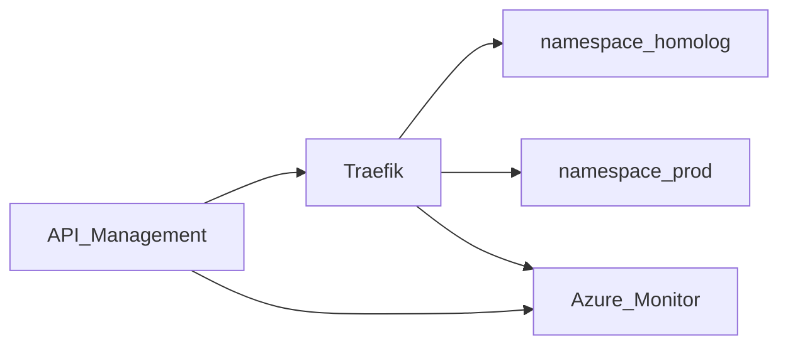

# WrenchBox — Kubernetes e borda

Terraform do AKS, do Traefik, do API Management, do Azure Monitor e dos alertas.

## Tecnologias

- Terraform `azurerm`, `helm`, `kubernetes` e `random`
- AKS com um node `Standard_B2s` e Container Insights
- Traefik, chart oficial
- API Management Consumption
- Application Insights e alertas do Azure Monitor
- GitHub Actions com OIDC

## Arquitetura deste repositório



O HPA da API (1 a 4 réplicas, CPU 60%, memória 75%) vive no repositório da aplicação. Este repositório entrega o metrics do AKS que o HPA consome.

O gateway exige JWT de cliente em `/api/v1/me`, JWT de administrador nas rotas operacionais e deixa abertos o login, o acompanhamento, o webhook e o `/health`. `POST /auth/token` vai para a função.

## Execução

Depende do resource group e do Key Vault criados pelo repositório do banco.

```bash
terraform init
terraform plan -var key_vault_name=kvwbXXXXX
terraform apply -var key_vault_name=kvwbXXXXX
```

Não há Dockerfile. O processo empacotado é a API, no outro repositório.

## Deploy

Pull request: `validate` e `plan`. Push em `homolog` e `main`: `apply` do mesmo estado remoto, então o segundo apply não cria outro cluster. Sem os segredos OIDC e as variáveis de state, `plan` e `apply` avisam e seguem, em vez de falhar no login. Variáveis: `KEY_VAULT_NAME`, `FUNCTION_BACKEND_URL_HOMOLOG`, `FUNCTION_BACKEND_URL_PROD`, `API_BACKEND_URL_HOMOLOG`, `API_BACKEND_URL_PROD`, `ALERT_EMAIL`, `TFSTATE_RESOURCE_GROUP`, `TFSTATE_STORAGE_ACCOUNT`. Segredos OIDC: `AZURE_CLIENT_ID`, `AZURE_TENANT_ID`, `AZURE_SUBSCRIPTION_ID`.

O primeiro `apply` do banco nasce com `terraform init -backend=false` e cria a conta de state. Depois, `terraform init -migrate-state` com o resource group, a conta `sttfwb…` e o container `tfstate`. As chaves são `wrenchbox-db.tfstate`, `wrenchbox-k8s.tfstate` e `wrenchbox-functions.tfstate`.

Depois do apply, grave `aks_name` e `resource_group_name` nas variáveis do repositório da API (`AKS_CLUSTER_NAME`, `AZURE_RESOURCE_GROUP`).

Swagger e Postman: repositório da aplicação, em `/swagger` e `docs/WrenchBox.postman_collection.json`.

## Alertas

- CPU do nó acima de 80%
- Consulta de logs com `WorkOrderProcessingFailed`
- Teste de disponibilidade em `/homolog/health`

Latência HTTP e uso de memória aparecem no Application Insights e no Container Insights.
